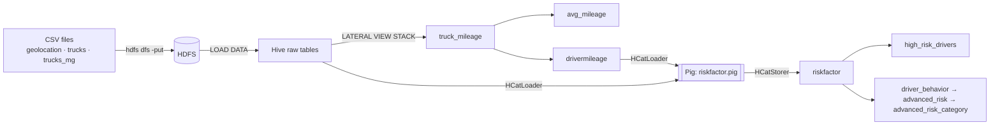
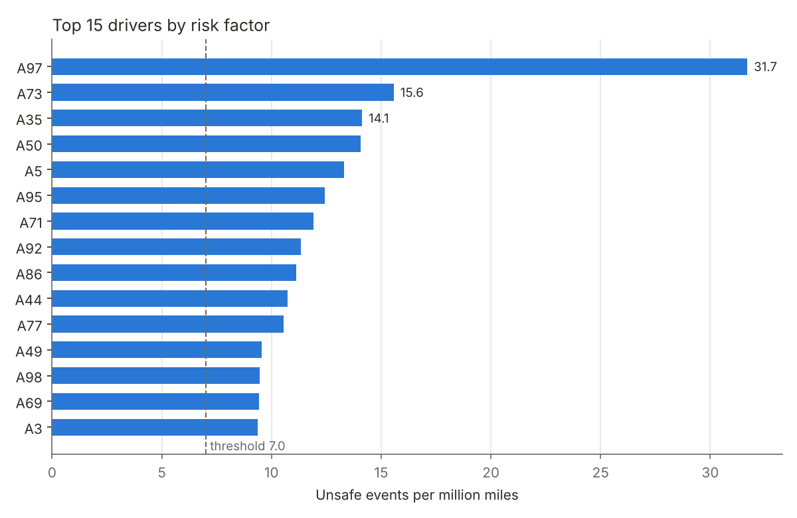
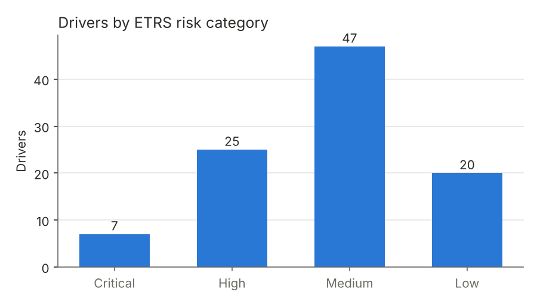

# Fleet Driver Risk Analysis on Hadoop (Hive + Pig)

**Course:** MIS 6346 Big Data, University of Texas at Dallas, Fall 2025
**Client scenario:** AZ National Trucking, a 100-truck fleet with telematics sensors
**Stack:** Hadoop HDFS · Hive (HiveQL) · Pig with HCatalog · Cloudera CDH 5.4 VM · Python (pandas, SciPy)

---

## The problem

Driver safety varies a lot across the fleet, and the company needed a defensible way to answer three questions:

1. Which drivers exceed the company's safety threshold?
2. Which drivers show consistently high risk?
3. Does the city a driver operates in influence risk?

## What I built

The full data pipeline, run end to end on a Cloudera Hadoop VM:

- Loaded the raw telematics and fleet data into **HDFS** and modelled it as **Hive** tables
- Unpivoted 54 months of per-truck mileage and fuel columns into 5,400 rows with `LATERAL VIEW STACK`
- Wrote the **Pig** job (via HCatalog) that computes each driver's risk factor
- Designed an **Enhanced Total Risk Score (ETRS)** that extends the course method with event frequency, speed and idling, and sorts drivers into Critical / High / Medium / Low tiers

A Python version of the pipeline was added after the course to double-check the numbers. It uncovered a data-loading bug in the original run (see [Data-quality fix](#data-quality-fix)).

## Architecture



| Step | File | What it does |
|---|---|---|
| 1 | [`sql/01_load_to_hdfs.sh`](sql/01_load_to_hdfs.sh) | Copies the three CSVs into HDFS |
| 2 | [`sql/02_create_base_tables.hql`](sql/02_create_base_tables.hql) | Creates and loads `geolocation`, `trucks`, `trucks_mg` |
| 3 | [`sql/03_mileage_tables.hql`](sql/03_mileage_tables.hql) | `truck_mileage` (unpivot), `avg_mileage`, `drivermileage` |
| 4 | [`sql/04_riskfactor.hql`](sql/04_riskfactor.hql) + [`pig/riskfactor.pig`](pig/riskfactor.pig) | Risk factor per driver, then the high-risk list |
| 5 | [`sql/05_advanced_risk.hql`](sql/05_advanced_risk.hql) | ETRS score and risk tiers |
| check | [`notebooks/driver_risk_analysis.ipynb`](notebooks/driver_risk_analysis.ipynb) | The same pipeline in pandas, plus statistics and charts |

**Risk factor** = unsafe events (overspeed, lane departure, unsafe following or tail distance) per million miles driven.

**ETRS** = 0.5 × (risk factor / 10) + 0.3 × (events / max events) + 0.1 × (avg velocity / max velocity) + 0.1 × (idling / max idling)

## Key findings

Figures below come from the corrected data (see the next section).



- **53 of 99 drivers** are at or above the 7.0 risk-factor threshold.
- **Risk is concentrated.** Driver **A97** (31.7) scores more than twice the next driver, A73 (15.6). The top 10 are A97, A73, A35, A50, A5, A95, A71, A92, A86 and A44.
- **Unsafe event frequency drives risk; speed and idling do not.** Events correlate with risk factor at r = 0.999. Average velocity (r = 0.09) and idling (r = 0.10) barely move it. ANOVA across risk tiers agrees: events differ sharply (p < 0.001), velocity (p = 0.92) and idling (p = 0.31) do not.
- **Speed and idling are two separate driving styles** (r = −0.71 with each other): fast with little idling, or slow with lots of idling. Neither predicts risk.
- **City effect: suggestive, not settled.** A Kruskal–Wallis test on unsafe events grouped by city is significant (H = 75.6, p = 0.022). Counting each driver once per city, the difference disappears (p = 0.99), so city-level risk deserves a closer look before acting on it.



ETRS tiers: **7 Critical**, 25 High, 47 Medium, 20 Low.

### Recommendations

1. Immediate coaching and route review for A97 and A73
2. City-level safety pilots in the highest-risk locations
3. Automated alerts on unsafe events and excessive idling
4. A monthly KPI report: top-20 drivers, city risk index, threshold breaches
5. A predictive model to flag drivers likely to escalate next month

## Data-quality fix

When the pipeline was re-run in Python, the event counts didn't match the class run. Every driver had exactly **2 × real events + 1**. Two problems combined:

1. `trucks_mg.csv` had been loaded **into the `geolocation` table** instead of `trucks_mg` ([screenshot 08](screenshots/08_trucks_mg_load_BUG_wrong_table.png): `numFiles=2`). Its date column landed in the `event` field, and since a date is not `'normal'`, every driver gained one fake "unsafe event".
2. The Pig job read **16,103 records** from `geolocation` instead of 8,000 ([screenshot 10](screenshots/10_pig_riskfactor_success.png)), which doubled the real events. Pig's `HCatLoader` also ignores Hive's `skip.header.line.count`.

**Impact:** the driver ranking stayed the same, but the absolute scores were about 2× too high, and the class run reported 92 drivers over the threshold instead of the correct 53. The fix is in `sql/02_create_base_tables.hql`, and step 9 of the notebook proves the 2x+1 pattern holds for all 99 drivers.

The lesson: `LOAD DATA INPATH` appends silently, so check row counts after every load.

## Run it yourself

**Python (no Hadoop needed):**
```bash
pip install pandas scipy matplotlib jupyter
cd notebooks && jupyter notebook driver_risk_analysis.ipynb
```

**Hadoop:** on any Hive + Pig environment (built on Cloudera CDH 5.4), run the files in `sql/` in order, and run the Pig step with `pig -useHCatalog pig/riskfactor.pig`.

## Repository layout

```
data/          raw inputs: geolocation.csv (8,000 events), trucks.csv (100 trucks × 54 months), trucks_mg.csv
sql/           HDFS load script and HiveQL, steps 1-5
pig/           riskfactor.pig
notebooks/     Python reproduction, statistics and charts
analysis/      corrected result tables, charts, and the original class-run output for comparison
screenshots/   26 terminal screenshots of the pipeline running on the Hadoop VM
```

## Data source

Sample truck-telematics data from the Hortonworks / Cloudera Hadoop tutorial ("Analyze IoT data with Hive and Pig"), provided by the course instructor. "AZ National Trucking" is the course's fictional client.

---

**Divya Dilip Sakre** · [GitHub](https://github.com/divyasakre) · <!-- add LinkedIn URL here -->
